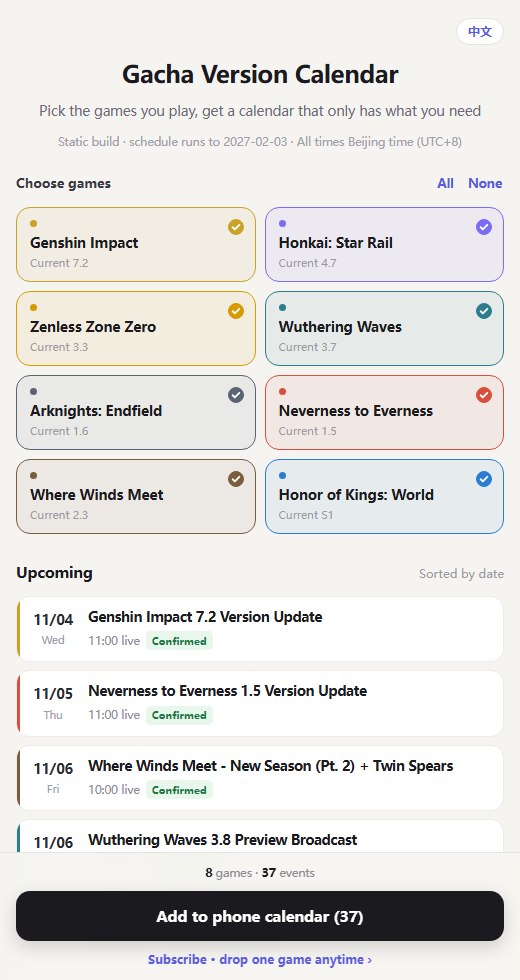

# Gacha Game Version Calendar

**English** · [简体中文](README.zh-CN.md)

Every preview stream, version update and promo-code deadline for the gacha games you play — turned into calendar events with reminders on your phone.

Tick the games you play on the web page, tap once, and the schedule lands in your phone's calendar. Quit a game and you switch off that one calendar; the rest keep working.

> **Android users: do not tap "Delete" to remove a subscription.** Many vendor calendar apps merge every URL subscription into one account called `Subscription Calendar`, so deleting one removes all of them. Switch the "show" toggle off instead. Details in [Removing a game](#removing-a-game) — this is the single most common support question.

### 👉 Use it now: [peterlikesfood453.github.io/Gacha-game-version-calendar/en/](https://peterlikesfood453.github.io/Gacha-game-version-calendar/en/)

No sign-up, no app install, no cost. Chinese version: [here](https://peterlikesfood453.github.io/Gacha-game-version-calendar/).

[](LICENSE)
[](https://www.python.org/)
[](#run-it-locally)
[](#contributing)



> Unofficial community project. All game names, trademarks and event content belong to their respective publishers; this project only aggregates timing information.

---

## Two builds, pick one

The repo ships two implementations that share the same data (`events.py`):

| | Static build | Full build (Python) |
|---|---|---|
| How to use | Open the web page, nothing to install | Run `python server.py` yourself or deploy it |
| Select games, one-tap import | Yes | Yes |
| Subscribable URL for a **custom mix** | No — only per-game or everything | Yes, generated on the fly from your selection |
| Running cost | Zero, hosted free on GitHub Pages | Needs a machine that runs Python |
| Location | `static/` | repo root |

**Static build:** https://peterlikesfood453.github.io/Gacha-game-version-calendar/en/

Want zero hassle and something to share with friends → static build. Want a long-lived instance where "Genshin + WuWa" is its own subscription URL → full build.

---

## Contents

- [What this is](#what-this-is)
- [What it does](#what-it-does)
- [Project layout](#project-layout)
- [On your phone](#on-your-phone)
- [Removing a game](#removing-a-game)
- [Run it locally](#run-it-locally)
- [Where the data lives](#where-the-data-lives)
- [How code expiry times are derived](#how-code-expiry-times-are-derived)
- [Endpoints](#endpoints)
- [Deploy the static build to GitHub Pages](#deploy-the-static-build-to-github-pages)
- [Deploy the full build](#deploy-the-full-build)
- [Translations](#translations)
- [Contributing](#contributing)
- [FAQ](#faq)
- [Known limitations](#known-limitations)
- [Roadmap](#roadmap)
- [License](#license)

---

## What this is

The official miHoYo calendar subscriptions (e.g. [hoyo_calendar](https://github.com/BlueflameLi/hoyo_calendar)) cover Genshin, Star Rail and ZZZ well. What was missing was something cross-publisher that lets you pick the games you actually play and build one calendar from them.

It solves three very concrete problems:

| The annoyance | What this does |
|---|---|
| You miss a preview stream and only learn about the codes afterwards | Reminder 30 minutes before the stream |
| You wait all morning on update day, but servers open in the afternoon | Reminders 1 day and 2 hours ahead |
| "Codes expire in a few hours" — expires when, exactly? | A separate event titled `<Game> <version> - Redemption codes expire`, accurate to the minute |

## What it does

- **8 games to tick**: Genshin Impact, Honkai: Star Rail, Zenless Zone Zero, Wuthering Waves, Arknights: Endfield, Neverness to Everness, Where Winds Meet, Honor of Kings: World
- **One-tap import**: pick games, tap the button, get an `.ics` file. On iPhone it opens straight into Calendar.
- **Subscribe per game**: one calendar per game, so quitting one game stops only that one
- **Merged subscription**: or put several games into a single calendar
- **Auto refresh**: subscribed calendars re-fetch every 6 hours; when the maintainer updates the data your phone follows
- **Status labels**: every event is marked `Confirmed` / `Estimated` / `TBC` / `Computed`, so guesses are never passed off as official
- **Zero dependencies**: Python standard library only, no `pip install`
- **Bilingual**: Chinese at `/`, English at `/en/`, generated from a single template

## Project layout

```
.
├── events.py               All data + ICS generation (the only file you edit for content)
├── strings.py              UI copy for both languages
├── server.py               Full build: single-port HTTP server
├── index.html              Full build page template
├── build_static.py         Static build: compiles events.py into static/
├── static/                 Static build (ready for GitHub Pages)
│   ├── template.html       Page template with the in-browser ICS generator
│   ├── index.html          Generated (Chinese) - do not edit by hand
│   ├── ics/                One file per game + all.ics (Chinese)
│   └── en/                 English page and ics/ tree
├── docs/screenshot-en.png  Screenshot used in this README
└── LICENSE
```

`static/index.html`, `static/en/index.html` and every `*.ics` are **build artifacts**. Edit `events.py`, `strings.py` or `static/template.html`, then rebuild.

## On your phone

### iPhone / iPad

1. Open the page in **Safari**
2. Tap the black **Add to phone calendar** button
3. Tap **Add All** in the popup

To follow future updates, use **Subscribe** below instead — iOS remembers the URL and syncs automatically.

### Android / HarmonyOS

1. Open the page in your browser
2. Tap **Add to phone calendar** — this downloads an `.ics` file
3. Open your calendar app, find **Import**, and select the file

For automatic updates use the app's **Add calendar from URL / Subscribe by URL** entry with the `https://` URL the page gives you. Read the warning above first: multiple URL subscriptions usually end up under one account.

### WeChat's built-in browser

WeChat blocks calendar imports. Tap `···` (top right) → **Open in browser**, then follow the steps above.

## Removing a game

Scroll to the **Subscribe & remove** card on the page. Each game has its own row; tapping **Remove** expands the steps for your platform.

**iPhone**: Calendar app → **Calendars** at the bottom → find *Genshin - Version Calendar* → ⓘ → **Delete Calendar**. iOS keeps every subscription independent, so only that one goes away.

**Android — this is the part that bites.** Many vendor calendar apps (vivo / OPPO / Xiaomi / Huawei) put every URL subscription you add under a single account named `Subscription Calendar`. **Deleting one of them there deletes all of them.** That is why Genshin and Star Rail vanished together. It is the app's behaviour, not a bug in this project, and no server-side change can prevent it.

So on Android, to stop one game:

1. Calendar app → Settings → Calendar accounts
2. Tap the matching row (the titles all read `Subscription Calendar`; the small text underneath tells you which game)
3. Switch **"show" off** — **do not tap Delete**
4. Reminders for that game stop immediately; the others are unaffected

If you want to delete them properly one at a time, use [ICSx⁵](https://icsx5.bitfire.at/) (free, open source): each subscription becomes an independent calendar there, and deleting one never touches the rest.

If you **imported the file once**, those events live on your phone. Nothing here can reach them — search for the game name in your calendar app and delete the events one by one, or switch to subscribing so removal becomes a single calendar.

## Run it locally

You need [Python 3.8+](https://www.python.org/downloads/). On Windows, tick **Add Python to PATH** during install.

```bash
git clone https://github.com/peterlikesfood453/Gacha-game-version-calendar.git
cd Gacha-game-version-calendar
python3 server.py
```

Then open `http://localhost:8000/` (Chinese) or `http://localhost:8000/en` (English).

Default port is 8000; override it with an environment variable:

```bash
PORT=8080 python3 server.py        # macOS / Linux
$env:PORT=8080; python server.py   # Windows PowerShell
```

No database, no `npm install`, no third-party packages.

## Where the data lives

**Everything is in `events.py`.** Content changes never touch the front end. Every entry carries both languages: `title` / `title_en`, `desc` / `desc_en`, `name` / `name_en`. If an English field is missing the generator falls back to Chinese, so partial translations never break the build.

### Games

```python
GAMES = [
    {"id": "genshin", "name": "原神", "name_en": "Genshin Impact",
     "short": "原神", "short_en": "Genshin", "ver": "7.2",
     "color": "#C9A227", "cycle": "42 天 · 周三更新 · 前瞻约提前 12 天",
     "cycle_en": "42-day cycle · Wednesday updates · Special Program ~12 days earlier"},
    ...
]
```

`id` is the slug used in URLs — never change it once published, or people's subscriptions break. `ver` is the current version shown on the card. `cycle` / `cycle_en` are display-only notes.

### Events

```python
EVENTS = [
    {"g": "genshin", "ver": "7.3", "kind": "preview",
     "dt": "2026-12-04 20:00", "dur": 60,
     "title": "原神 7.3 前瞻特别节目", "status": "est",
     "desc": "按 42 天周期推算...",
     "title_en": "Genshin Impact 7.3 Special Program",
     "desc_en": "Projected from the 42-day cycle..."},
    ...
]
```

| Field | Meaning |
|---|---|
| `g` | game id, must match `GAMES` |
| `ver` | version string, e.g. `7.3` |
| `kind` | `preview` stream / `release` update / `code` code expiry (`code` is generated, do not hand-write it) |
| `dt` | Beijing time, format `YYYY-MM-DD HH:MM` |
| `dur` | duration in minutes |
| `title` / `title_en` | event title shown in the calendar |
| `status` | `official` / `est` projected / `tbd` not announced / `rule` computed |
| `desc` / `desc_en` | event details, with the source when it is official |

### Real example: the date becomes official

Say Genshin 7.3 moves its stream to Dec 5, 20:00:

```python
# before
{"g": "genshin", "ver": "7.3", "kind": "preview",
 "dt": "2026-12-04 20:00", "dur": 60,
 "title": "原神 7.3 前瞻特别节目", "status": "est",
 "desc": "按 42 天周期推算..."},

# after: fix the date, flip status, record the source
{"g": "genshin", "ver": "7.3", "kind": "preview",
 "dt": "2026-12-05 20:00", "dur": 60,
 "title": "原神 7.3 前瞻特别节目", "status": "official",
 "desc": "官方公告：https://..."},
```

Restart the server and it is live. Subscribers pick it up within six hours.

> The code-expiry event is derived from `CODE_RULE`, so it recalculates itself when you move the stream time.

### Rebuild the static site

The static build does not read `events.py` at runtime — it reads compiled output:

```bash
python build_static.py
```

This rewrites `static/index.html`, `static/en/index.html` and both `ics/` trees. Commit `static/` with your data change.

If you edit `events.py` directly on GitHub you do **not** need to run it: the included GitHub Actions workflow rebuilds and publishes to Pages on push.

## How code expiry times are derived

Not a vague "a few hours" — each rule is matched against a real 2026 stream:

| Game | Rule | Real example |
|---|---|---|
| Genshin Impact | 12:00 on day 3 after the stream | streamed Oct 23 evening → expired Oct 26, 12:00 |
| Honkai: Star Rail | 23:59 the next day | streamed Oct 30 → expired Oct 31, 23:59 |
| Zenless Zone Zero | 23:59 on day 2 | streamed Oct 9 → expired Oct 11, 23:59 |
| Wuthering Waves | 23:59 on day 2 | streamed Sep 19 → expired Sep 21, 23:59 |
| Neverness to Everness | 23:59 on day 4 | streamed Oct 28 → expired Nov 1, 23:59 |
| Endfield / Where Winds Meet / HoK: World | no preview codes at all | so no such event exists |

The rules live in `CODE_RULE`:

```python
CODE_RULE = {
    "genshin": dict(day=3, at="12:00", note="直播后第 3 天中午 12:00", note_en="12:00 on day 3 after the stream"),
    "hsr":     dict(day=1, at="23:59", note="直播次日 23:59", note_en="23:59 the day after the stream"),
    ...
}
```

Change one entry and every event recomputes.

Because publishers only state the exact minute in the stream's closing credits, these events are labelled `Computed` rather than `Confirmed`. Expect an error margin under one hour.

## Endpoints

| Path | What it returns |
|---|---|
| `/` | Chinese picker page |
| `/en` | English picker page |
| `/calendar.ics?games=genshin,zzz` | Calendar for the selected games. Unknown ids are ignored; an empty parameter means all games. Add `&lang=en` for English |
| `/all.ics` | All games |
| `/sub/<id>.ics` | Single-game subscription calendar, with removal instructions in the calendar description |
| `/game/<id>.ics` | Same, legacy path kept for compatibility |

Game ids:

| id | Game | id | Game |
|---|---|---|---|
| `genshin` | Genshin Impact | `endfield` | Arknights: Endfield |
| `hsr` | Honkai: Star Rail | `nte` | Neverness to Everness |
| `zzz` | Zenless Zone Zero | `wwm` | Where Winds Meet |
| `wuwa` | Wuthering Waves | `hokw` | Honor of Kings: World |

On iOS subscribe with `webcal://your-domain/sub/genshin.ics`; on Android use **Add calendar from URL** with the same address as `https://`.

Language resolution: `?lang=en` wins, then the `/en` path prefix, then `Accept-Language` (English first for anything that is not Chinese).

## Deploy the static build to GitHub Pages

Fork it and you get a permanent free site — no server, no cost.

1. **Fork** this repo (top right → **Create fork**)
2. In your fork: **Settings** → **Pages**
3. Set **Source** to **GitHub Actions** (not *Deploy from a branch*)
4. Open the **Actions** tab and wait for `Build static site` to go green (~1 minute)
5. Visit `https://<your-name>.github.io/<repo>/` for Chinese, `.../en/` for English

After that `.github/workflows/pages.yml` rebuilds and republishes whenever `events.py`, `strings.py` or `static/` changes — you only maintain the data.

Local preview:

```bash
# Option 1: build, then open static/index.html directly (data is inlined)
python build_static.py

# Option 2: serve it so URLs behave exactly like production
python build_static.py
python -m http.server 8000 --directory static
```

## Deploy the full build

A single-port Python program. Anywhere that runs Python works; configuration is one command, `python server.py`, with the port read from `PORT`.

- **Render / Railway**: new Web Service, connect the repo, start command `python server.py`, the platform injects `PORT`
- **Your own VPS**: `git clone`, then keep it alive with `systemd` or `nohup` behind Nginx
- **A home machine or NAS**: fine on your LAN; expose it with a tunnel if you need outside access

## Translations

The project follows the usual two-language open-source layout:

- `README.md` is English (the GitHub default), `README.zh-CN.md` is Chinese; each links to the other at the top
- The site serves Chinese at `/` and English at `/en/`, with a language switch in the top-right corner and mutual `<link rel="alternate" hreflang>` tags for search engines
- **One template, two builds.** `static/template.html` and `index.html` contain `{{key}}` placeholders; `strings.py` holds the copy for both languages and `build_static.py` renders each language at build time. Nothing is swapped at runtime, so `<html lang>`, `<title>` and the calendar files are genuinely English.

Adding a language means adding one dictionary to `strings.py` and one set of `*_xx` fields in `events.py` — the templates do not change.

Notes for translators: keep times written as "Beijing time (UTC+8)" and never soften `Estimated` / `TBC` into `Confirmed`.

## Contributing

Data goes stale every week, so **the most valuable contribution is a date correction, not code**.

### With GitHub (preferred)

1. **Fork** the repo
2. Open `events.py` in your fork and use the pencil icon to edit in the browser
3. Describe the change at the bottom and hit **Commit changes**
4. Open **Pull requests** → **New pull request** against the original repo

### Without writing any code

Open an [issue](https://github.com/peterlikesfood453/Gacha-game-version-calendar/issues) with these four lines:

```
Game: Genshin Impact
Version: 7.3
Correct time: 2026-12-05 20:00 (UTC+8)
Source: https://official-announcement-link
```

### Before you submit

- Times are always Beijing time, format `YYYY-MM-DD HH:MM`
- Unsure? Use `est` or `tbd`. **Never** mark something `official` to make it look better
- `official` requires a source link in `desc`
- Do not delete confirmed entries from others; only update them
- Adding a game means updating both `GAMES` and `CODE_RULE` (if it hands out codes), and adding the `_en` fields

## FAQ

**I see every event twice.**
You probably imported the file *and* subscribed to the same calendar. Keep one: on iOS untick the subscribed calendar; on Android switch its "show" toggle off (do not delete it).

**I deleted one game's subscription and the others disappeared.**
A known Android vendor-calendar behaviour — see [Removing a game](#removing-a-game). Several URL subscriptions share one account, so a delete hits the account. No data is lost; add them back. From now on, switch "show" off instead of deleting.

**Why are some dates marked Estimated?**
Games follow fixed cycles (miHoYo titles: 42 days, Wednesday updates) and publishers only confirm one or two weeks ahead. Until then the date is projected and may slip by a few days. The label tells you which entries you can rely on.

**Does it update by itself?**
If you subscribe, yes — your phone re-fetches within six hours of any data change. If you imported a file, you need to import again.

**Why can't the site delete events from my calendar with one tap?**
Calendar subscriptions are read-only: the server publishes, and only your phone knows what you subscribed to. Remote deletion would require tracking every subscriber's identity, and losing that record would silently empty everyone's calendar. Keeping the calendar reliable matters more, so removal happens on your device — in three taps.

**Are these dates accurate?**
`Confirmed` comes from official announcements. `Estimated`, `TBC` and `Computed` are derived and will drift once the official date lands. If you spot an error, open an issue.

## Known limitations

- **Data is maintained by hand.** There is no scraper; a date only changes when someone updates it
- **Code expiry is rule-derived**, so it can be off by up to an hour once officially announced
- **Imported events are decoupled from the server** — cancelling means deleting them one by one. Subscribe if you want easy removal
- **The server cannot delete events from anyone's phone.** Removal is a client-side action by design
- **Android vendor calendars merge URL subscriptions into one account**, so deleting one deletes all. A client limitation this project cannot fix
- **Honor of Kings: World is season-driven and Where Winds Meet has no preview streams**, so those two are naturally sparser — nothing is missing
- **Only 8 games are covered.** See [Contributing](#contributing) to add more
- **The static build cannot subscribe to a custom mix** — only per-game or everything. Use the full build for "Genshin + WuWa"

## Roadmap

- **v1 full build (done)**: Python server, subscribable URL for any combination, per-game removal
- **v2 static build (done and live)**: pure static, calendar computed in the browser, free on GitHub Pages
- **v2.1 English build (done)**: `/en/` plus English calendar files, same data
- **v3 (optional)**: pull from community data sources to cut manual maintenance

## License

[MIT](LICENSE). Use it, change it, redistribute it — keep the copyright notice.

If this saved you from missing a code drop, a star is enough.
