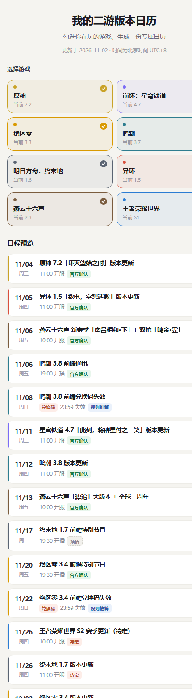

# 二游版本日历 · Gacha Game Version Calendar

把国产二次元游戏的**版本前瞻直播**、**版本更新**、**前瞻兑换码失效时间**，变成手机日历里一条条带提醒的日程。

在网页上勾选你在玩的游戏，点一下，日程就进手机日历了。退坑了就把对应的那个日历删掉，提醒一起消失。

[](LICENSE)
[](https://www.python.org/)
[](#在自己电脑上跑)
[](#参与维护)



> 本项目是非官方社区项目。所有游戏名称、商标、活动内容归各自厂商所有，本项目只做时间信息的汇总整理。

---

## 目录

- [这是什么](#这是什么)
- [能做什么](#能做什么)
- [手机上怎么用](#手机上怎么用)
- [不想自己部署](#不想自己部署用现成链接)
- [在自己电脑上跑](#在自己电脑上跑)
- [数据在哪，怎么改](#数据在哪怎么改)
- [兑换码失效时间是怎么算的](#兑换码失效时间是怎么算的)
- [接口一览](#接口一览)
- [部署到自己的服务器](#部署到自己的服务器)
- [参与维护](#参与维护)
- [常见问题](#常见问题)
- [已知限制](#已知限制)
- [路线图](#路线图)
- [License](#license)

---

## 这是什么

米哈游自家的日历订阅（比如 [hoyo_calendar](https://github.com/BlueflameLi/hoyo_calendar)）已经做得很好，但只覆盖原神、星铁、绝区零三家。

跨厂商、还能自己挑要哪几款再生成一份日历的，当时没找到，于是自己写了一个。它解决三个很具体的问题：

| 你会遇到的问题 | 这个项目怎么解决 |
|---|---|
| 前瞻直播错过，回来才知道发了兑换码 | 直播前 30 分钟提醒 |
| 版本更新当天白等一上午，其实下午才开服 | 提前 1 天、提前 2 小时各提醒一次 |
| 兑换码"几小时内失效"，到底几点？ | 单独一条日程，标题写着「XX 版本 前瞻兑换码失效」，时间精确到分钟 |

## 能做什么

- **8 款游戏可勾选**：原神、崩坏：星穹铁道、绝区零、鸣潮、明日方舟：终末地、异环、燕云十六声、王者荣耀世界
- **一键导入**：勾选完点按钮，生成一个 `.ics` 文件，iPhone 直接弹「全部添加」
- **按游戏单独订阅**：一款游戏一份日历，退坑只删那一个，其他游戏不受影响
- **合并订阅**：也可以把几款游戏塞进同一个日历
- **自动刷新**：订阅的日历每 6 小时拉取一次，作者更新数据后手机自动跟上
- **状态标注**：每条日程都标了 `官方确认` / `预估` / `待定` / `规则推算`，不会把猜的当官方
- **零依赖**：只用 Python 标准库，不用 `pip install` 任何东西

## 手机上怎么用

### iPhone / iPad

1. 用 **Safari** 打开网页（不要用微信）
2. 点最下面黑色的 **「加入手机日历」**
3. 弹窗点 **「全部添加」**

想长期跟着更新，就点下面那行「订阅日历」，日历 App 会记住这个地址，以后自动同步。

### 安卓 / 华为 / 小米 / 鸿蒙

1. 用系统浏览器打开网页
2. 点 **「加入手机日历」**，下载 `.ics` 文件
3. 打开系统日历 App，找「导入」「从文件导入」一类的入口，选中刚下载的文件

想长期同步，用日历 App 的「从网址添加日历」，填网页上给的 `https://` 订阅地址。

### 微信里打不开怎么办

微信内置浏览器不允许导入日历。点右上角 `···`，选 **「在浏览器打开」**，再按上面的步骤操作。

### 怎么取消

页面拉到最下面有「订阅与取消」卡片，每个游戏一行，点「取消」会展开三步操作：进日历 App → 找到「原神 · 版本日历」这类名字 → 删除日历。

订阅的日历删掉就彻底没了。如果是当初**一次性导入**的，那些日程已经写进手机本地，只能手动逐条删：在日历里搜游戏名，一条条删掉。

## 不想自己部署：用现成链接

作者维护了一个示例站：

```
https://game-version-calendar-88236.app.workbuddy.host/?sharecode=ZLRI2TFV7G
```

可以直接用，但请注意：**这是个人实例，可能随时下线**。想让服务长期稳定，最好自己部署一份（见下文），或者把项目跑在自己电脑上。

## 在自己电脑上跑

需要装 [Python 3.8 或更高版本](https://www.python.org/downloads/)。安装时 Windows 用户记得勾选 **Add Python to PATH**。

```bash
# 1. 下载代码
git clone https://github.com/peterlikesfood453/Gacha-game-version-calendar.git
cd Gacha-game-version-calendar

# 2. 启动
python3 server.py
```

Windows 上如果 `python3` 不认，用 `python server.py`。

然后在浏览器打开 `http://localhost:8000/` 就能看到页面。

默认端口 8000，想换端口就设环境变量：

```bash
PORT=8080 python3 server.py     # macOS / Linux
$env:PORT=8080; python server.py  # Windows PowerShell
```

不需要数据库，不需要 `npm install`，没有任何第三方依赖。

## 数据在哪，怎么改

**所有数据都在 `events.py` 这一个文件里**，改数据不用碰前端。

### 游戏列表

```python
GAMES = [
    {"id": "genshin", "name": "原神", "short": "原神", "ver": "7.2",
     "color": "#C9A227", "cycle": "42 天 · 周三更新 · 前瞻约提前 12 天"},
    ...
]
```

`id` 是网址里用的短名，一旦定了别改（别人订阅的链接会失效）；`ver` 是当前版本号，显示在网页上；`cycle` 是更新周期说明，纯展示用。

### 日程

```python
EVENTS = [
    {"g": "genshin", "ver": "7.3", "kind": "preview",
     "dt": "2026-12-04 20:00", "dur": 60,
     "title": "原神 7.3 前瞻特别节目", "status": "est",
     "desc": "按 42 天周期推算。B站 / 抖音 / 米游社 官方直播间..."},
    ...
]
```

| 字段 | 含义 |
|---|---|
| `g` | 游戏 id，要和 `GAMES` 里的一致 |
| `ver` | 版本号，比如 `7.3` |
| `kind` | `preview` 前瞻直播 / `release` 版本更新 / `code` 兑换码失效（`code` 由程序自动生成，不用手写） |
| `dt` | 北京时间，格式固定 `YYYY-MM-DD HH:MM` |
| `dur` | 时长，单位分钟 |
| `title` | 日历里显示的标题 |
| `status` | `official` 官方确认 / `est` 按周期推算 / `tbd` 官方未公布 / `rule` 按规则推算 |
| `desc` | 点开日程看到的详情，写清楚来源 |

### 一个真实例子：官方公布了日期

假设官方宣布原神 7.3 前瞻改到 12 月 5 日 20:00，你只需要这样改：

```python
# 改之前
{"g": "genshin", "ver": "7.3", "kind": "preview",
 "dt": "2026-12-04 20:00", "dur": 60,
 "title": "原神 7.3 前瞻特别节目", "status": "est",
 "desc": "按 42 天周期推算..."},

# 改之后：日期改对，状态改成 official，把来源写进 desc
{"g": "genshin", "ver": "7.3", "kind": "preview",
 "dt": "2026-12-05 20:00", "dur": 60,
 "title": "原神 7.3 前瞻特别节目", "status": "official",
 "desc": "官方公告：https://... （在此贴上公告链接）"},
```

改完**重启服务**就生效。订阅了日历的人，手机六小时内会自动收到新时间。

> 注意：兑换码失效那条日程是程序按 `CODE_RULE` 自动算的，你改了前瞻时间，它会跟着自动重算，不用动。

## 兑换码失效时间是怎么算的

不是拍的"几小时"，是拿 2026 年每款游戏真实的一场直播对出来的规则：

| 游戏 | 失效规则 | 实际例子 |
|---|---|---|
| 原神 | 直播后第 3 天 12:00 | 10/23 晚播 → 10/26 12:00 失效 |
| 崩坏：星穹铁道 | 直播次日 23:59 | 10/30 播 → 10/31 23:59 失效 |
| 绝区零 | 直播后第 2 天 23:59 | 10/9 播 → 10/11 23:59 失效 |
| 鸣潮 | 直播后第 2 天 23:59 | 9/19 播 → 9/21 23:59 失效 |
| 异环 | 直播后第 4 天 23:59 | 10/28 播 → 11/1 23:59 失效 |
| 终末地 / 燕云十六声 / 王者荣耀世界 | 不发前瞻兑换码 | 所以没有这一类日程 |

规则集中写在 `events.py` 的 `CODE_RULE` 里：

```python
CODE_RULE = {
    "genshin": dict(day=3, at="12:00", note="直播后第 3 天中午 12:00"),
    "hsr":     dict(day=1, at="23:59", note="直播次日 23:59"),
    ...
}
```

发现某款游戏的规则变了，改这里一处，全局生效。

因为官方只在直播结尾字幕里报具体时刻，所以这类日程标注为 `规则推算`，不冒充官方确认。误差一般在 1 小时内。

## 接口一览

| 路径 | 说明 |
|---|---|
| `/` | 选择页，勾选游戏、预览日程 |
| `/calendar.ics?games=genshin,zzz` | 按所选游戏生成日历。未知 id 自动忽略，参数为空等于全选 |
| `/all.ics` | 全部游戏 |
| `/sub/<id>.ics` | 单个游戏的订阅日历，带"不玩了就删掉"的说明 |
| `/game/<id>.ics` | 单游戏日历（旧路径，保留兼容） |

游戏 id 对照：

| id | 游戏 | id | 游戏 |
|---|---|---|---|
| `genshin` | 原神 | `endfield` | 明日方舟：终末地 |
| `hsr` | 崩坏：星穹铁道 | `nte` | 异环 |
| `zzz` | 绝区零 | `wwm` | 燕云十六声 |
| `wuwa` | 鸣潮 | `hokw` | 王者荣耀世界 |

iOS 订阅用 `webcal://你的域名/sub/genshin.ics`；安卓在日历 App 里「从网址添加」，填 `https://` 开头的同一个地址。

## 部署到自己的服务器

这是个单端口的 Python 小程序，任何能跑 Python 的地方都能部署，配置只需要一条命令：`python server.py`，端口读环境变量 `PORT`。

几个免费或低成本的选择：

- **Render / Railway**：新建 Web Service，连接这个仓库，Start Command 填 `python server.py`，平台会自动注入 `PORT`
- **自己的 VPS**：`git clone` 之后用 `systemd` 或 `nohup` 挂着，前面套 Nginx
- **家里的电脑 / NAS**：局域网内可用；想让外网访问需要做内网穿透

部署完成后把域名填进网页，或者直接把 `/sub/genshin.ics` 这样的地址贴进手机日历。

## 参与维护

数据会过期，官方每周都在公布新日期，所以这个项目**最需要的贡献是改日期，不是写代码**。

### 方式一：你会用 GitHub（推荐）

1. 点右上角 **Fork**，把仓库复制到你自己的账号下
2. 在你的仓库里打开 `events.py`，点右上角铅笔图标直接网页编辑
3. 改完在页面底部写一句改了什么，点 **Commit changes**
4. 回到原仓库点 **Pull requests** → **New pull request**，把你的改动提上来

### 方式二：你完全不会写代码

直接开一个 [Issue](https://github.com/peterlikesfood453/Gacha-game-version-calendar/issues)，写清楚这四件事就够了：

```
游戏：原神
版本：7.3
正确日期：2026-12-05 20:00（北京时间）
来源：https://官方公告链接
```

维护者会替你改进代码里。

### 提交前请自查

- 日期一律北京时间，格式 `YYYY-MM-DD HH:MM`
- 不确定就标 `est` 或 `tbd`，**不要**为了好看标成 `official`
- `official` 必须附官方来源链接，写在 `desc` 里
- 不要删除别人已确认的条目，只做更新
- 新增游戏时，同时补 `GAMES` 和 `CODE_RULE`（如果它发兑换码）

## 常见问题

**问：导入后发现日程重复了两份？**
答：你可能既导入了一次性文件，又订阅了同一个日历。进日历 App 把订阅的那个删掉，或者反向操作，只留一种。

**问：为什么有些日期标着"预估"？**
答：各游戏按固定周期更新（米哈游系 42 天、周三），官方通常提前一两周才公布。没公布之前只能按周期推，误差可能有几天。标出来是为了让你知道哪条能当真、哪条仅供参考。

**问：能自动更新吗？我什么都不想管。**
答：用「订阅」就是自动的。订阅后你什么都不用做，作者更新了数据，你手机六小时内自动同步。用「一次性导入」则需要重新导一次。

**问：为什么不能在网页上点一下就把别人日历里的日程删掉？**
答：日历订阅是只读协议，服务器只负责发内容，谁订了、存了哪些日程，只有那台手机自己知道。想做到网页远程删除，就必须在服务器记录每个订阅者的身份，而这份记录一旦丢失，所有人的日历会静默变空。比起远程删除的便利，手上这份日历的可靠性更重要，所以选择了一游戏一日历、删除在手机上完成。

**问：微信里点开会跳到下载页？**
答：微信内置浏览器禁止导入日历。点右上角 `···` → 在浏览器打开即可。

**问：这些日期准吗？**
答：标 `官方确认` 的来自官方公告，基本可信；标 `预估`、`待定`、`规则推算` 的都是推算结果，官方公布后会有偏差。发现错误欢迎提 Issue。

## 已知限制

- **数据是人工维护的**，没有自动抓官方接口，官方改档期后需要有人更新才会变
- **兑换码失效时刻是规则推算**，官方公布后可能有 1 小时内的偏差
- **一次性导入的日程与服务器脱钩**，取消只能手动逐条删；想随时取消请用订阅
- **服务端无法远程删除任何人手机上的日程**，所以取消动作在手机端完成
- **王者荣耀世界按赛季推进、燕云十六声没有前瞻直播**，这两款的条目天生比米哈游系稀疏，不是漏了
- **只覆盖 8 款游戏**，不是所有二游。想加新游戏请看[参与维护](#参与维护)

## 路线图

- **v1（当前）**：Python 服务端，支持任意游戏组合的日历与订阅。要自己部署一份才能用。
- **v2（计划中）**：纯静态版，日历在浏览器里现拼，托管到 GitHub Pages，**零成本、零服务器**，任何人 fork 之后打开链接就能用。代价是"任意组合的订阅链接"做不了，只能给每款游戏预生成订阅文件。
- **v3（可选）**：接入社区数据源自动更新排期，减少人工维护成本。

## License

[MIT](LICENSE)。随便用、随便改、随便分发，保留版权声明即可。

如果这个项目帮你省了几次"早知道昨天直播就发了"，给个 Star 就够了。
